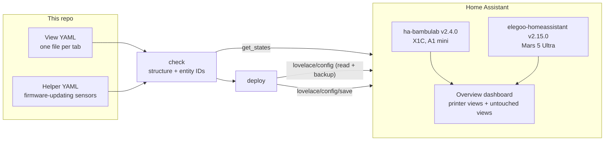
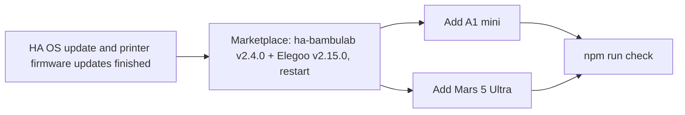
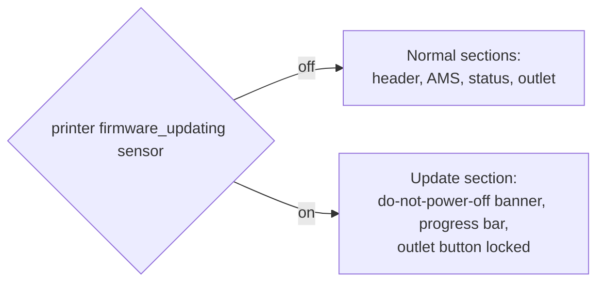

# Home Assistant 3D printer dashboards

The printer tabs of a Home Assistant **Overview** dashboard (Bambu Lab X1C, Bambu Lab A1 mini, Elegoo Mars 5 Ultra), kept as YAML in git and deployed over HA's WebSocket API.

**Why:**

- The tabs broke silently. Integrations renamed or dropped entities, and nothing noticed. `check` fails on any entity a view references that HA doesn't have.
- Editing them in the UI leaves no history. Here, every change is one reviewable commit.
- The Overview dashboard has other tabs this repo must never touch. `deploy` swaps only the views it owns and verifies the rest are unchanged.

## Architecture

| Piece | How it works |
|---|---|
| View files | Each file is one Lovelace view, exactly as HA stores it, keyed by the view's `path`. The file name must equal `path`. |
| Helper files | Documentation of the template helpers the views depend on (created once in the HA UI). `check` verifies each helper's entity exists. |
| `check` | Parses every file and validates its structure. It then collects every entity ID (see below), fetches `get_states` read-only, and fails on anything missing. It also dry-merges into the live Overview to catch duplicate paths and bad `after` / `replaces` targets. |
| `deploy` | Runs `check`, fetches the live Overview, prints a diff, writes a timestamped backup, and saves. It then re-fetches and verifies that every unmanaged view and dashboard setting equals the backup. |
| Token | Read at runtime from 1Password with `op read`, or from `HA_TOKEN`. It's held in memory only. Set `HA_OP_REF` (an `op://` reference) and optionally `HA_URL` in the environment or a gitignored `.env.local`, so account details stay out of the repo. Use vault/item **IDs** in the reference if a name contains `(`, which `op` can't parse. |

The views are tabs of the default dashboard (storage mode), not separate dashboards. That's why the scripts talk to `lovelace/config` with `url_path: null`. HA can only save the whole dashboard at once, so deploys must run one at a time.

## Usage

| Command | Does |
|---|---|
| `npm install` | Installs the single dependency (`yaml`). Needs Node 22+ for the built-in WebSocket. |
| `npm run check` | Full check against live HA (read-only) |
| `npm run check:offline` | YAML and structure only, with no HA connection |
| `npm run deploy:dry` | Check, then show the diff per managed view and the resulting tab order. Saves nothing. |
| `npm run deploy` | Check, back up, save, verify |
| `npm run deploy -- --only <path>` | Same, for a single view (works with `deploy:dry` too) |

A view that matches the live one reports `unchanged`, and a run where nothing changed saves nothing. Key order is ignored when comparing.

If verification fails, the backup is the complete previous dashboard config. Save it back through the dashboard's raw configuration editor.

### View file rules

| Key | Meaning |
|---|---|
| `path`, `title` | Required. `path` matches the file name and the URL of the tab. |
| `type: sections` + `sections`, or `cards` | The view body, as in HA's raw config editor |
| `replaces: <old-path>` | First deploy takes over the slot (position and visibility) of `<old-path>`. Later deploys match by `path`. It's an error if both views exist live. |
| `after: <path>` | Where a **new** view is inserted. The target may be live or deployed in the same run. Ignored once the view exists, and a view with no `after` goes at the end. |
| `visible` | **Not allowed.** It holds HA user IDs. Deploy keeps whatever the live view has, so set it in the HA UI. |

`after` and `replaces` are stripped before saving. IP addresses are rejected because the repo is public: use entity IDs and hostnames.

**Entity detection.**
- Any string value that's exactly `domain.object_id` for a known HA domain counts as an entity reference.
- Inside templates (`{{ }}`, ``, button-card `[[[ ]]]`), quoted IDs and `states.domain.id` count.
- Values under `service` / `action` / `perform_action` (e.g. `button.press`) and file names like `off.png` are skipped.

## Prerequisites

These are user steps, because they need Marketplace installs or printer access codes.

**Marketplace:** HA 2026.11 replaced HACS with the built-in **Marketplace**: sidebar → **Marketplace** (admin users only). Accept its warning once; installs and updates don't work until you do.

| Step | Click path |
|---|---|
| Upgrade ha-bambulab to **v2.4.0** | Marketplace → search "Bambu Lab" → open it → pick **v2.4.0** → install/update. **Skip v2.3.0.** |
| Install Elegoo **v2.15.0** | Marketplace → search "Elegoo" (if it isn't listed, add the custom repository `danielcherubini/elegoo-homeassistant`, type Integration) → open it → pick **v2.15.0** (not the 2.16 beta) → install |
| Restart once | Settings → System → ⋮ (top right) → Restart Home Assistant |
| Add the A1 mini | Settings → Devices & services → Bambu Lab → **Add entry** → choose **LAN** → printer IP, serial and access code (both on the printer's screen, under Settings → Network) |
| Add the Mars 5 Ultra | Settings → Devices & services → **Add integration** → Elegoo Printer → it's discovered on the LAN, or enter its IP |

**"Cloudflare has blocked the connection attempt" when adding a Bambu printer.**
- **Cause:** ha-bambulab v2.3.0 flooded Bambu's cloud API, and Bambu's Cloudflare then blocked the integration's user agent. That includes older versions like 2.2.x.
- **Fix:** v2.4.0 changes the user agent. Upgrade, restart, then add the printer.
- **Alternative:** the **LAN** option never touches the cloud.

## Design decisions

### Bambu tabs are read-only

| Fact | Consequence |
|---|---|
| X1C firmware 01.12 encrypts local MQTT, and Developer Mode is off | ha-bambulab can read status but cannot send commands |
| The pause/resume/stop buttons and the speed select don't exist as entities | The tabs show status, AMS, spools and the camera (when it streams). Speed profile is a read-only tile. Print control stays in Bambu Studio / Handy. |
| Turning Developer Mode on would restore control, but it disables cloud features | Not adopted; revisit if local control matters more |

The Mars 5 Ultra (SDCP protocol) does accept local commands, so its tab keeps the integration's controls.

### Firmware-update display mode

While a printer flashes firmware, its sensors go stale, and cutting outlet power can brick the board. Each Bambu tab therefore has two mutually exclusive modes:

- **Signal:** `update.<printer>_firmware_update` exposes `in_progress` and `update_percentage` as attributes. Section `visibility` conditions can't read attributes, so a template binary sensor per printer turns `in_progress` into a state. Its definition lives in the repo's helper files.
- **Whole-tab switch:** every normal section is visible only when the sensor is `off`, and the update section only when it's `on`. No half-stale mix.
- **Two safeguards on power:** in update mode the outlet button is replaced by a locked variant. The normal button's tap action also resolves to `none` while updating.

### Cards

All cards come from ha-bambulab's bundled card pack (v0.8.1 with integration v2.4.0), so nothing extra is installed:

- The AMS graphic card per AMS unit fixes black and white spools disappearing against a dark background.
- The spool card for external spools.
- The print-status card where it renders without controls.

**X1C tab notes:**
- The print-status card (graphic style) replaced the hand-placed picture-elements header. It shows temperatures, fans, door, progress and the cover image, and its light is the Bambu chamber light. The enclosure WLED (`light.dexbu_x1c_lights`) has its own card in the lights section.
- `camera.dexbu_x1c_camera` is shown only while it isn't `unavailable`.
- The AMS humidity graphs use the Aqara `sensor.ams_2_pro_climate_*` sensors; the old `sensor.3d_printer_climate_*` ones are gone.
- The update entity can stay `in_progress: true` at 100% after an update finishes, so the firmware-updating helper also requires a pending version or a percentage below 100.
- No `fapro:` icons. `thomasloven/hass-fontawesome` was removed upstream (deprecated), so the tab uses only `mdi:` icons and the bundled cards.

## WLED stability (X1C chamber lights)

**Symptom:** HA shows the WLED light as unavailable or flapping, while the WLED phone app "works".

**Cause:**
- The controller is an ESP32-C3 at weak signal (around −68 dBm).
- HA holds a **persistent websocket** to WLED. Each drop logs `No PONG received after 15.0 seconds`, and the device often reboots.
- The WLED app polls over plain HTTP, so short drops go unnoticed there.

| Fix | Where |
|---|---|
| Lower Wi-Fi TX power (ESP32-C3 boards are known to be unstable at full power) | WLED → Config → WiFi Setup → TX power |
| Disable Wi-Fi sleep | WLED → Config → WiFi Setup → "Disable WiFi sleep" |
| Reserve the DHCP lease so the address never moves | Router DHCP settings |
| Optional: newer WLED firmware | HA's WLED update entity |

**Verify:** uptime in WLED's `/json/info` keeps climbing, and HA's system log shows no new `No PONG` entries over 24 h.

## Evaluated, not adopted

| Project | Why not (for now) |
|---|---|
| [hausch1ld/Universal-3D-Printer-card](https://github.com/hausch1ld/Universal-3D-Printer-card) | Printer-agnostic and reported working with the Elegoo integration (FDM). Not in the default Marketplace list, and resin is untested. Candidate for the Mars tab if the native cards look poor. |
| [drkpxl/printwatch-card](https://github.com/drkpxl/printwatch-card) | Bambu all-in-one, but it overlaps the official cards and assumes controls exist |
| [WolfwithSword/Bambu-HomeAssistant-Flows](https://github.com/WolfwithSword/Bambu-HomeAssistant-Flows) | Needs Node-RED flows; heavier than the native cards |
| [maziggy/bambuddy](https://github.com/maziggy/bambuddy) | A whole self-hosted Bambu server; separate project, out of scope |
| [Timmes123/ha-bambu-filaments](https://github.com/Timmes123/ha-bambu-filaments) | Needs a Bambu cloud login; no LAN mode |

## Public-repo hygiene

- **Never committed:** tokens, IP addresses, printer serials, HA user IDs.
- **Git-ignored:** backups (they contain user IDs) and raw API dumps.
- **What views use instead:** entity IDs and ha-bambulab `device_id`s, which are opaque registry IDs.
